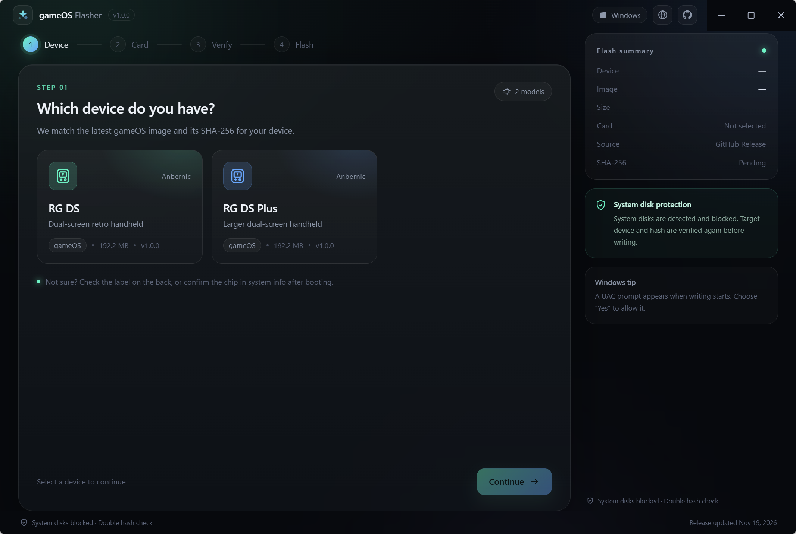
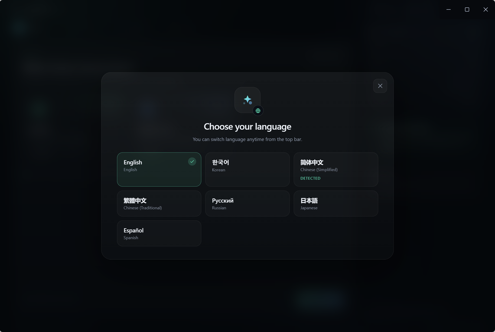
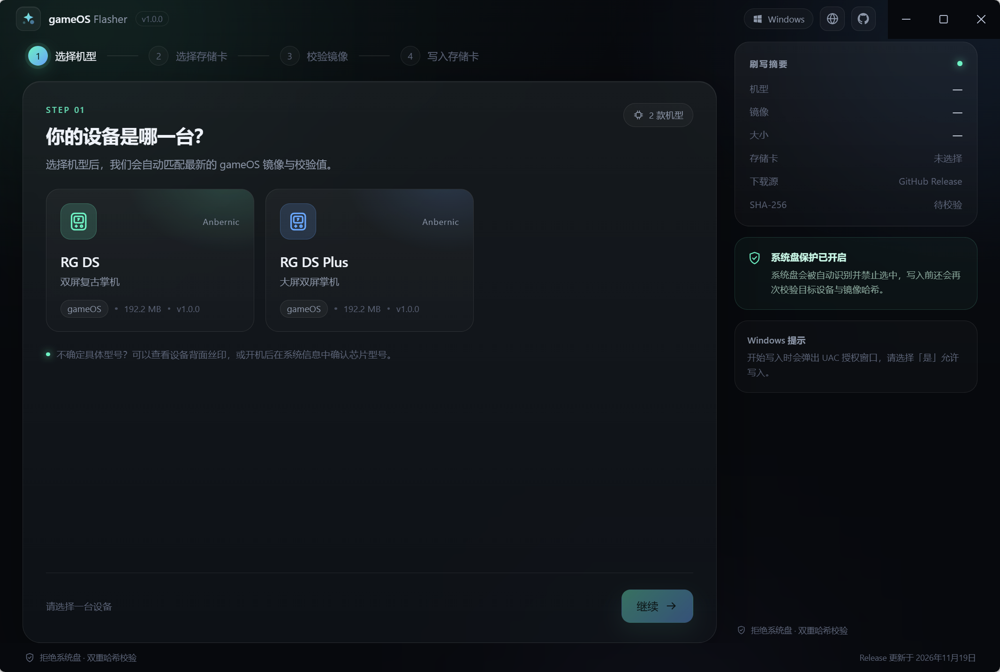

# gameOS Flasher

**English** | [简体中文](#简体中文)

---

## English

A graphical tool that flashes gameOS onto your SD card with one click. Works on Windows and macOS.

gameOS Flasher automatically fetches the latest image from the [gameOS repository](https://github.com/oh-sudo-user/gameOS) GitHub releases, verifies its SHA-256, decompresses the gzip archive, and writes it to your card. Built-in system-disk protection and double hash verification keep your data safe.



Pick your language on first launch, and switch anytime from the button in the top-right corner:



### Features

- **Automatic image fetch** — resolves the latest gameOS release and matches the correct `.img.gz` per device, no manual downloads
- **Double SHA-256 verification** — verified once after download and again before writing, so the image can't be corrupted or swapped
- **System-disk protection** — system and internal disks are detected and blocked; read-only devices are skipped
- **Automatic gzip decompression** — download → verify → decompress → flash, fully automated
- **Cache reuse** — downloaded images are cached locally and reused when the hash matches
- **Local images** — already have an `.img` / `.img.gz` file? Flash it directly
- **Multilingual UI** — English, 简体中文, 繁體中文, 日本語, 한국어, Русский, Español. Pick on first launch, switch anytime

### Supported Devices

| Device | Image |
| --- | --- |
| Anbernic RG DS | `gameOS-rgds.img.gz` |
| Anbernic RG DS Plus | `gameOS-rgds-plus.img.gz` |

### Requirements

- Windows 10 or later (x64), or macOS 12 or later (Intel / Apple Silicon)
- A microSD card of 8GB or larger (A1/A2 recommended)
- About 2.5GB of free disk space for the cache (archive + decompressed image)

### Download & Install

Grab the latest build from the [releases page](https://github.com/oh-sudo-user/gameOS-flasher/releases/latest):

- **Windows**: `gameOS-Flasher-x.y.z-x64.exe` — run the installer
- **macOS**: `gameOS-Flasher-x.y.z-<arch>.dmg` — not included in v1.0.0 yet (must be built on macOS); will ship in a later release

### How to Use

1. **Pick your device** — RG DS or RG DS Plus, the matching image is selected automatically
2. **Insert your card** — choose it from the list; system disks are blocked automatically
3. **Download & verify** — the image is downloaded, SHA-256 verified and decompressed automatically
4. **Confirm & flash** — check the backup acknowledgment and start writing, with live progress and speed

> Flashing erases everything on the card. Back up your data first.

### Build from Source

```bash
# Node.js 20.19+ / 22.12+
npm install
npm run dev          # local development

npm run dist:win     # build the Windows installer (NSIS)
npm run dist:mac     # build the macOS DMG (must run on macOS)
```

### Project Layout

```
src/
├── main/        # Electron main process: disk enumeration, download/verify, elevated flashing
├── preload/     # preload script exposing typed IPC APIs
├── renderer/    # React UI (four-step wizard)
└── shared/      # shared types and 7-language strings
resources/
├── manifest.json     # device manifest and release matching rules
└── flash-helper.js   # privileged write helper (Windows UAC / macOS authorization)
```

### FAQ

- **Why does Windows show a UAC prompt?** Writing to a raw device requires administrator privileges. Choose "Yes" to continue.
- **Why does macOS ask for my password?** The card must be unmounted and opened for writing, which requires admin authorization.
- **"Image pending" message?** The latest gameOS release doesn't include an image for this device yet. Once it's published, hit "Check again".
- **Where are downloaded images stored?** In the `images` folder of the app data directory (Windows: `%APPDATA%\gameos-flasher`). Safe to delete after flashing.

### License

[MIT](LICENSE)

---

## 简体中文

把 gameOS 一键刷进存储卡的图形化工具，支持 Windows 与 macOS。

gameOS Flasher 会自动从 [gameOS 仓库](https://github.com/oh-sudo-user/gameOS)的 GitHub Release 获取最新镜像，完成 SHA-256 校验与 gzip 解压后写入存储卡。内置系统盘保护与双重哈希校验，避免误写与镜像损坏。



首次启动时会先选择界面语言，之后可随时通过右上角按钮切换：


### 功能特性

- **自动获取镜像**：自动解析 gameOS 最新 Release，按机型匹配 `.img.gz`，无需手动下载
- **双重 SHA-256 校验**：下载完成后校验一次，写入前再校验一次，确保镜像未被调包或损坏
- **系统盘保护**：自动识别系统盘与内置磁盘并禁止选中，只读设备自动跳过
- **gzip 自动解压**：下载压缩包 → 校验 → 解压 → 刷写，全流程自动完成
- **缓存复用**：已下载的镜像会缓存在本地，校验一致时直接复用，无需重复下载
- **本地镜像**：已有 `.img` / `.img.gz` 文件？可以直接选择本地文件刷写
- **多语言界面**：English、简体中文、繁體中文、日本語、한국어、Русский、Español，首次启动时选择，随时可切换

### 支持机型

| 机型 | 镜像 |
| --- | --- |
| Anbernic RG DS | `gameOS-rgds.img.gz` |
| Anbernic RG DS Plus | `gameOS-rgds-plus.img.gz` |

### 系统要求

- Windows 10 及以上（x64），或 macOS 12 及以上（Intel / Apple Silicon）
- 8GB 及以上容量的 microSD 卡（建议 A1/A2 高速卡）
- 缓存盘需要预留约 2.5GB 可用空间（压缩包 + 解压镜像）

### 下载安装

前往 [Releases 页面](https://github.com/oh-sudo-user/gameOS-flasher/releases/latest) 下载最新版：

- **Windows**：`gameOS-Flasher-x.y.z-x64.exe`，双击安装
- **macOS**：`gameOS-Flasher-x.y.z-<arch>.dmg`（v1.0.0 暂未提供，需在 macOS 上构建，后续版本发布）

### 使用步骤

1. **选择机型** — RG DS 或 RG DS Plus，自动匹配对应镜像
2. **插入存储卡** — 从列表中选择目标卡，系统盘会被自动屏蔽
3. **下载并校验** — 自动下载镜像、校验 SHA-256 并解压
4. **确认写入** — 勾选确认备份后开始刷写，全程显示进度与速度

> 刷写会清空存储卡上的全部数据，请提前备份。

### 从源码构建

```bash
# Node.js 20.19+ / 22.12+
npm install
npm run dev          # 本地开发调试

npm run dist:win     # 构建 Windows 安装包（NSIS）
npm run dist:mac     # 构建 macOS 安装包（DMG，需在 macOS 上执行）
```

### 目录结构

```
src/
├── main/        # Electron 主进程：磁盘枚举、下载校验、提权刷写
├── preload/     # 预加载脚本，暴露类型安全的 IPC API
├── renderer/    # React 界面（四步向导）
└── shared/      # 主/渲染进程共享类型与 7 语言文案
resources/
├── manifest.json     # 机型清单与 Release 匹配规则
└── flash-helper.js   # 提权写入助手（Windows UAC / macOS 授权）
```

### 常见问题

- **Windows 弹出 UAC 窗口？** 正常现象。写入物理设备需要管理员权限，请选择「是」。
- **macOS 要求输入密码？** 写入存储卡前需要卸载并打开设备，需要管理员授权。
- **提示「镜像待发布」？** 表示 gameOS 仓库的最新 Release 还没有该机型的镜像，等镜像发布后点击「重新检查」即可。
- **下载的镜像存放在哪？** 缓存位于应用数据目录的 `images` 文件夹（Windows：`%APPDATA%\gameos-flasher`），可在刷写完成后安全删除。

### 许可证

[MIT](LICENSE)
